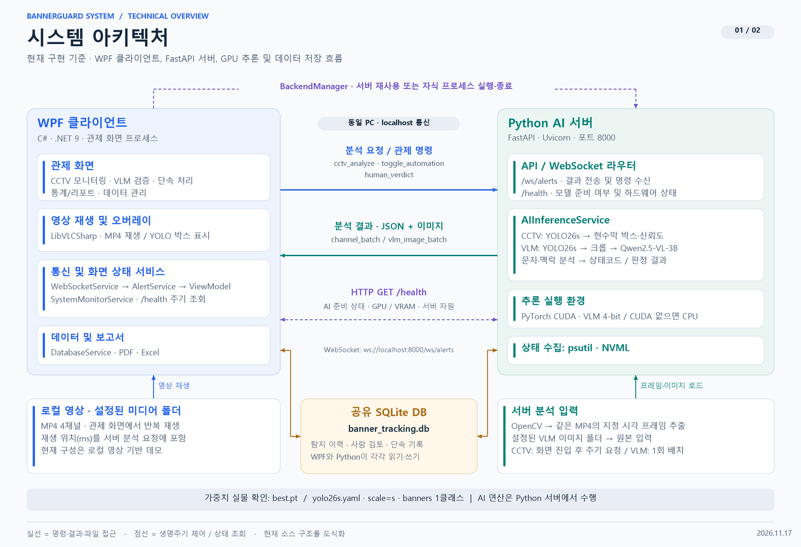

# BannerGuardSystem | AI 현수막 관제 시스템

**영상에서 현수막을 탐지하고, 이미지의 문구와 맥락을 분석해, 관제관의 최종 판정과 단속 기록 관리를 돕는 Windows 데스크톱 앱입니다.**

[상세 포트폴리오](https://app.notion.com/p/222045186b3b831cbabd81c0a6af7b3f) · [시연 영상](https://docs.google.com/videos/d/1aZVHS13DnwQFeBqG0gLBE155NHy8MCqOovBZN0tpx9A/edit?scene=id.p#scene=id.p) · [문서 색인](docs/README.md)

## 무엇을 할 수 있나요?

| 화면 | 사용 흐름 |
| --- | --- |
| CCTV 모니터링 | 로컬 MP4 4채널을 재생합니다. 서버가 재생 위치의 프레임에서 현수막을 탐지하면 화면에 해당 영역을 표시합니다. |
| VLM 검증 | 별도의 이미지 폴더에서 현수막 영역을 찾아 잘라낸 뒤, Qwen이 문구와 맥락을 분석합니다. 관제관이 결과를 보고 합법·불법·재검토를 결정합니다. |
| 단속 처리 현황 | 판정과 단속 기록을 SQLite에 저장하고, 기록 조회·통계·PDF 및 Excel 출력을 지원합니다. |

## 시스템 구조

[](docs/assets/diagrams/2026-11-17/system_architecture_20261117.png)

- **WPF · C# · .NET 9**에서 영상 재생, 탐지 오버레이, 화면 상태와 사용자 명령을 처리합니다. [MVVM 다이어그램](docs/03-architecture/mvvm.md)
- **FastAPI · Python · WebSocket**으로 앱과 AI 서버가 분석 명령과 결과를 주고받습니다. 앱이 서버를 시작하고 `/health`로 모델 준비 상태를 확인합니다. [통신 계약](docs/03-architecture/protocol.md)
- **YOLO26s**는 CCTV 프레임과 이미지에서 `banners` 한 클래스를 탐지합니다. 이미지 검증에서는 **Qwen2.5-VL-3B-Instruct**가 탐지 영역의 문자와 맥락을 분석합니다. [모델 카드](docs/05-ai/model-card.md)

## 실행하기

Windows에 .NET 9 SDK와 Python 3.13을 준비합니다. GPU 분석은 NVIDIA GPU 및 호환 드라이버가 필요합니다. 저장소를 받은 뒤 루트에서 실행합니다.

```powershell
.\setup.bat
.\run.bat
```

`setup.bat`은 Python 가상 환경을 만들고 의존성 설치와 WPF 빌드를 진행합니다. 첫 실행에서 Qwen 가중치를 내려받을 수 있도록 인터넷과 디스크 공간을 확보하세요. 화면이 열린 뒤 모델을 준비하는 동안 대기 상태가 표시될 수 있습니다.

GitHub에서 받은 프로젝트는 개인정보를 포함하지 않는 **합성 영상 4개와 합성 이미지 1개**로 실행됩니다. 보유한 영상과 이미지는 로컬 설정에서 지정할 수 있습니다. [설치·설정·문제 해결](docs/04-development/getting-started.md)

## 구현 및 검증

| 항목 | 확인한 결과 |
| --- | --- |
| 화면 연동 | 기존 영상 4채널 재생과 탐지 오버레이, VLM 검증, 단속 목록 |
| 자동 시험 | 데스크톱 6개, Python 11개 로컬 통과 |
| GPU | RTX 3080에서 CUDA YOLO 탐지와 단일 이미지 VLM 분석 확인 |
| 모델 학습 | 학습 실행의 epoch 200 검증 기록에서 mAP50 0.99146, mAP50–95 0.96025 |

mAP는 해당 검증셋의 **현수막 객체 탐지** 지표입니다. 불법 여부 판정의 전체 정확도는 별도 평가가 필요합니다. [AI 평가 근거](docs/05-ai/evaluation.md) · [시험 결과](docs/06-testing/test-results.md)

```powershell
dotnet test BannerGuardSystem.sln -c Release
.\.venv\Scripts\python.exe -m pip install -r src/backend/requirements.test.txt
.\.venv\Scripts\python.exe -m pytest tests/backend -q
.\.venv\Scripts\python.exe scripts/verify.py
```

## 개발 범위와 기술적 개선

1인 프로젝트로 2026년 4–6월에 개발했고 이후 구조 정리와 시험을 추가했습니다. 기획, YOLO 학습, WPF 화면, Python 서버, DB·보고서 연동을 구현했습니다.

- 탐지 좌표를 영상 원본 크기와 화면의 여백 기준으로 변환해 화면 비율이 달라져도 박스가 영상 영역에 맞도록 했습니다.
- 데스크톱 앱이 시작하는 Python 서버의 경로와 출력 인코딩을 설정해, 설치 위치가 달라지거나 로그에 한글이 포함돼도 서버를 시작할 수 있도록 했습니다.

## 저장소 둘러보기

| 경로 | 내용 |
| --- | --- |
| [src/desktop](src/desktop) · [src/backend](src/backend) | WPF 클라이언트와 FastAPI 서버 |
| [models](models) · [training/yolo](training/yolo) | 현수막 탐지 가중치, 모델 정보, 학습 코드 |
| [data/samples](data/samples) · [database](database) | 합성 입력, 공유 SQLite 스키마와 마이그레이션 |
| [tests](tests) · [scripts](scripts) | 자동 시험과 설치·실행·배포 도구 |
| [docs](docs) | 요구사항, 아키텍처, 검증 결과와 수정 방향 |

[기술 회고](docs/08-portfolio/retrospective.md) · [배포 방법](docs/07-operations/deployment.md) · [남은 문제와 수정 방향](docs/07-operations/문제점.md) · [제3자 구성요소 출처](THIRD_PARTY_NOTICES.md)
