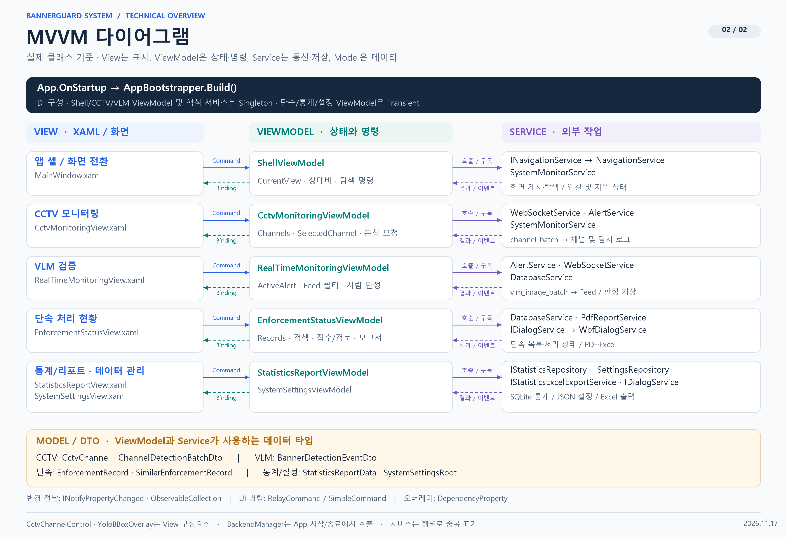

# MVVM 구조

상태: 현행 / 최종 검토: 2026-11-17.

View는 XAML과 UI 수명주기를 담당한다. ViewModel은 선택 상태와 Command, Service는 통신·DB·보고서, Model/DTO는 화면 및 통신 데이터를 표현한다.

| 화면 | ViewModel | 중심 서비스 |
|---|---|---|
| 셸 | ShellViewModel | NavigationService, SystemMonitorService |
| CCTV | CctvMonitoringViewModel | WebSocketService, AlertService |
| VLM | RealTimeMonitoringViewModel | AlertService, DatabaseService |
| 단속 | EnforcementStatusViewModel | DatabaseService, PdfReportService |
| 통계 | StatisticsReportViewModel | IStatisticsRepository, ExcelExport |
| 설정 | SystemSettingsViewModel | ISettingsRepository |

서비스 파일은 Communication, Persistence, Monitoring, Reporting, Presentation 등으로 분류했다. 폴더 이동 시 XAML과 기존 참조를 보존하기 위해 C# namespace는 유지했다. DB 서비스는 기존 진입점을 유지하는 partial 파일로 판정·단속·이력을 나눴다.

LibVLC 핸들, 오버레이 배치, WebView 초기화는 UI 의존 코드이므로 View에 남겼다. 화면 이름 변경과 추가 인터페이스 도입은 별도 후속 개선으로 분리한다.
