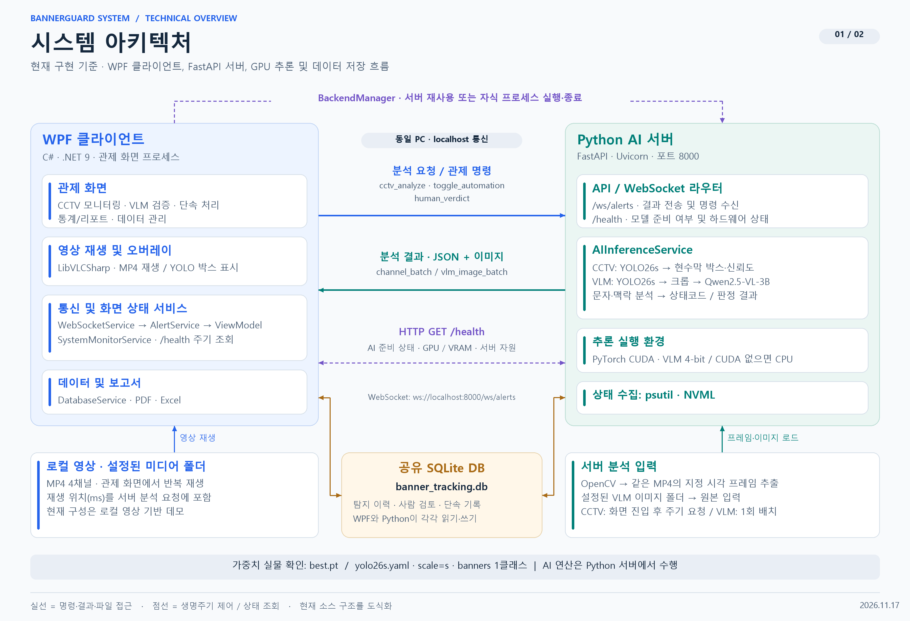

# 시스템 아키텍처

상태: 현행 / 최종 검토: 2026-11-17.

WPF와 Python은 별도 프로세스다. `BackendManager`는 기존 서버 재사용과 자신이 실행한 서버의 소유권을 관리한다. WPF는 LibVLC로 영상을 재생하고 재생 시각을 전달하며, Python은 같은 MP4의 지정 시각 프레임을 OpenCV로 읽는다.

`/ws/alerts`는 분석 명령과 배치 결과를 전달한다. `/health`는 모델 준비와 GPU·VRAM 등의 상태를 제공한다. 무거운 모델은 백그라운드에서 지연 로드하며 API import와 순수 파서는 모델 다운로드 없이 검사할 수 있다.

경로는 [공통 설정](../../configs/paths.example.json)에 정의한다. 환경변수 → 로컬 설정 → 예시 설정 순서로 적용하며 현재 작업 폴더와 무관하게 해석한다. 개발 생성물은 `runtime/`에 모은다.

두 프로세스는 같은 SQLite를 사용하고 [공유 마이그레이션](../../database/migrations/001-initial.sql)을 트랜잭션 안에서 적용한다. DB 직접 공유는 로컬 단일 PC 데모의 선택이며 다중 서버 서비스로 확장할 때 별도 저장 API와 쓰기 소유권 분리가 필요하다.

[MVVM](mvvm.md) · [DB](database.md) · [프로토콜](protocol.md) · [설계 결정](decisions/001-local-desktop-ai.md)
